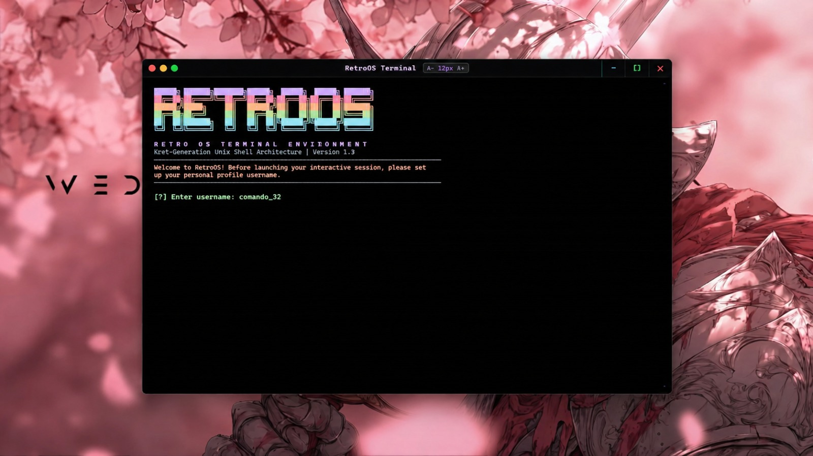
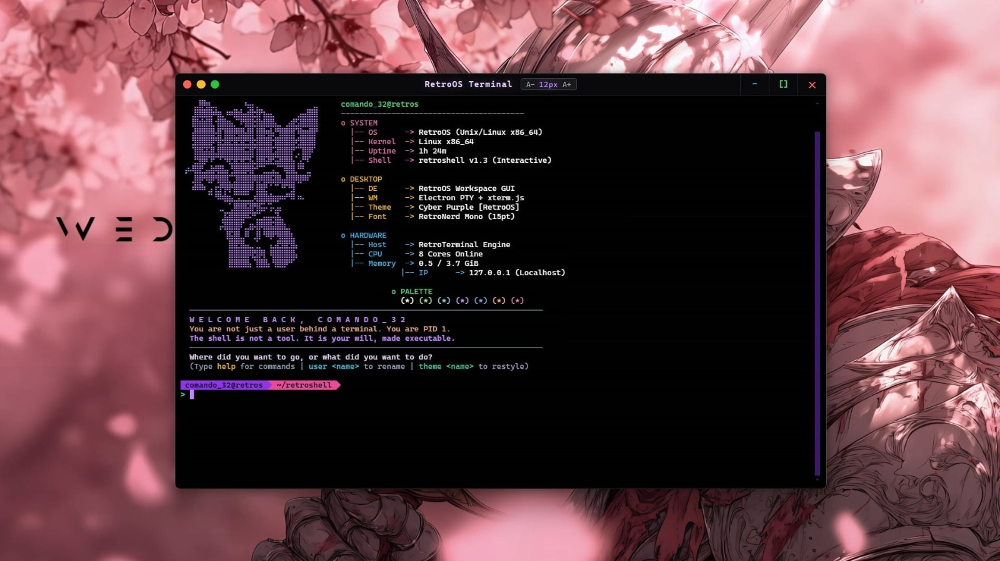

# RetroOS Shell (CSE210 Operating Systems Lab Edition)

> RetroOS is an interactive Unix shell and operating systems simulation laboratory developed entirely in GNU Bash (4.0+). It bridges standard POSIX shell utilities (REPL, command pipelines, I/O redirection, job control) with comprehensive demonstrations of foundational Operating System concepts—including CPU Scheduling, Process Control Blocks (PCB), Concurrency and Deadlocks, Dijkstra's Banker's Algorithm, and Virtual Memory Management.

---

## Screenshots Showcase





---

## Table of Contents
1. [Screenshots Showcase](#screenshots-showcase)
2. [Academic Overview](#academic-overview)
3. [System Architecture](#system-architecture)
4. [Core Operating System Modules](#core-operating-system-modules)
   - [1. CPU Scheduling and Gantt Chart](#1-cpu-scheduling-and-gantt-chart-schedsh)
   - [2. Process Control Block and Process Lifecycle](#2-process-control-block-and-process-lifecycle-pcbsh--forkdemosh)
   - [3. Concurrency and Race Conditions](#3-concurrency-and-race-conditions-racesh)
   - [4. Deadlock Detection, Prevention and Avoidance](#4-deadlock-detection-prevention-and-avoidance-deadlocksh--bankerssh)
   - [5. Virtual Memory and Page Replacement](#5-virtual-memory-and-page-replacement-memorysh)
   - [6. Kernel Interface and Hardware Monitoring](#6-kernel-interface-and-hardware-monitoring-sysinfosh)
5. [Shell Environment Features](#shell-environment-features)
6. [Directory Structure](#directory-structure)
7. [Getting Started and Installation](#getting-started-and-installation)
   - [Running on Linux or WSL (Recommended)](#running-on-linux-or-wsl-recommended)
   - [Running on Windows (Git Bash)](#running-on-windows-git-bash)
8. [Command Reference Cheatsheet](#command-reference-cheatsheet)
9. [Academic Metadata](#academic-metadata)

---

## Academic Overview

The objective of this project is to provide a rigorous, interactive bridge between operating system theory and execution behavior. Designed for CSE210 (Operating Systems), RetroOS provides empirical verification for:

- Process State Transitions and Schedulers: Dynamic queue simulation of New, Ready, Running, and Terminated states alongside visual Gantt charts.
- Mutual Exclusion and Critical Sections: Empirical observation of non-deterministic lost updates in shared files and verification of atomic mutual exclusion.
- Deadlock Theory: Practical demonstration of the four Coffman conditions, cycle detection in Wait-For Graphs, and proactive avoidance using Dijkstra's Banker's Algorithm.
- Demand Paging and Memory Hierarchy: Simulation of FIFO, LRU, and Optimal page replacement with formal proof of Belady's Anomaly.
- Kernel Telemetry: Direct inspection of the Linux `/proc` pseudo-filesystem to extract live task structures (`task_struct`), scheduling parameters, and hardware statistics.

---

## System Architecture

```
+-------------------------------------------------------------------------+
|                              RetroOS Shell                              |
|   (Interactive REPL, History, Aliases, Job Control, Pipes, Redirects)   |
+-----------------------------------+-------------------------------------+
                                    |
            +-----------------------+-----------------------+
            |                                               |
            v                                               v
+-----------------------+                       +-----------------------+
|    OS Lab Modules     |                       |    Core Libraries     |
| (lab/modules/*.sh)    |                       | (lab/lib/*.sh)        |
+-----------------------+                       +-----------------------+
| * sched.sh   (CPU)    |                       | * ui.sh    (Colors,   |
| * pcb.sh     (States) |                       |             Locks)    |
| * memory.sh  (Paging) |                       | * theme.sh (Themes &  |
| * race.sh    (Mutex)  |                       |             Prompt)   |
| * deadlock.sh(Coffman)|                       | * banner.sh(Sysinfo   |
| * bankers.sh (Safety) |                       |             Banner)   |
| * sysinfo.sh (Kernel) |                       +-----------------------+
| * forkdemo.sh(Fork)   |
+-----------------------+
```

---

## Core Operating System Modules

### 1. CPU Scheduling and Gantt Chart (`sched.sh`)
Implements non-preemptive and preemptive scheduling algorithms with interactive Gantt charts, computing Turnaround Time (TAT = Completion Time - Arrival Time) and Waiting Time (WT = Turnaround Time - Burst Time).

- Supported Algorithms:
  - FCFS (First-Come, First-Served): Non-preemptive execution scheduled strictly by arrival timestamp.
  - SJF (Shortest Job First): Non-preemptive algorithm that minimizes average waiting time.
  - Priority Scheduling: Non-preemptive execution prioritized by integer weight (smaller integer = higher priority).
  - Round Robin (RR): Time-sliced preemptive execution with customizable quantum (q).
- Comparative Benchmark (`sched compare`):
  Executes all four scheduling policies side-by-side against an identical workload to empirically verify theoretical performance metrics.

```bash
# Syntax: arrival:burst[:priority]
sched rr 2 0:5 1:3 2:8             # Round Robin with time quantum = 2
sched compare 0:5:2 1:3:1 2:8:3    # Side-by-side comparative analysis
```

---

### 2. Process Control Block and Process Lifecycle (`pcb.sh` & `forkdemo.sh`)
- Live PCB Extraction (`pcb [PID]`):
  Reads live Linux kernel data structures from `/proc/$PID/status` and `/proc/$PID/stat`:
  - Process ID (PID), Parent Process ID (PPID), User ID (UID), and State.
  - Virtual Memory (`VmSize`) and Resident Set Size (`VmRSS`).
  - Open File Descriptors count.
  - Voluntary and Non-voluntary Context Switches.
- Discrete State Simulator (`pcb sim`):
  Traces clock ticks under Round Robin to display exact process lifecycle transitions:
  ```
  New --(admit)--> Ready --(dispatch)--> Running --(finish)--> Terminated
                     ^                      |
                     +---(time slice)-------+
  ```
- Process Subsystem Primitives (`forkdemo`):
  Walkthrough of POSIX process calls: `fork()` memory duplication, `exec()` image overlay, `wait()` status collection, anonymous pipes, zombie process observation (state Z), and signal handling (`SIGTERM`, `SIGINT`).

---

### 3. Concurrency and Race Conditions (`race.sh`)
Examines the Critical Section Problem when concurrent worker processes manipulate shared state without synchronization.

- Unsynchronized Execution (Bug): Multiple asynchronous subshells execute read-modify-write sequences on a shared counter file, resulting in lost updates due to race conditions.
- Synchronized Execution (Fix): Implements mutual exclusion through atomic lock files using `set -o noclobber`, serializing the critical section without external dependencies.
- Output: Displays a performance table contrasting lost updates against 100% correct synchronized execution alongside synchronization time overhead.

---

### 4. Deadlock Detection, Prevention and Avoidance (`deadlock.sh` & `bankers.sh`)
- Deadlock Simulation (`deadlock`):
  - Spawns concurrent threads requesting resources in inverted order (T1 takes A then B vs T2 takes B then A).
  - Visualizes the circular wait condition on a Wait-For Graph (WFG): T1 -> Resource B -> T2 -> Resource A -> T1.
  - Demonstrates deadlock prevention strategies:
    1. Lock Ordering (prevents Circular Wait).
    2. Try-Lock Back-off (prevents Hold and Wait).
  - Explains the four Coffman Conditions (Mutual Exclusion, Hold and Wait, No Preemption, Circular Wait).
- Dijkstra's Banker's Algorithm (`bankers`):
  - Maintains state vectors and matrices: Available, Allocation, Max, and derives Need = Max - Allocation.
  - Runs the safety algorithm step-by-step to identify a safe sequence (e.g., <P1, P3, P4, P0, P2>).
  - Evaluates live resource requests, granting resources only if the resulting state remains safe, thereby preventing deadlock proactively.

---

### 5. Virtual Memory and Page Replacement (`memory.sh`)
Simulates page frame allocation and demand paging mechanisms when physical memory frames are saturated:

- Algorithms Implemented:
  - FIFO (First-In, First-Out): Replaces the page resident in memory the longest.
  - LRU (Least Recently Used): Replaces the page unreferenced for the longest elapsed duration.
  - OPT (Belady's Optimal): Theoretical benchmark replacing the page not referenced for the longest interval in the future.
- Belady's Anomaly Demonstration (`memory belady`):
  Empirically proves that increasing allocated frames from 3 to 4 on reference string `1 2 3 4 1 2 5 1 2 3 4 5` increases page faults from 9 to 10 under FIFO, demonstrating why stack algorithms (LRU) are superior.

---

### 6. Kernel Interface and Hardware Monitoring (`sysinfo.sh`)
- Simulated Dual-Mode Switching (`mode-switch`):
  Toggles simulated privilege levels between Ring 3 (User Mode, prompt `>`) and Ring 0 (Kernel Mode, prompt `#`) to illustrate system call traps and privilege separation.
- Hardware and Memory Telemetry (`meminfo`, `kinfo`, `monitor`):
  Displays live RAM allocation bars, CPU utilization sampling from `/proc/stat`, context switch counters, and system uptime.
- System Call Tracing (`trace <cmd>`):
  Attaches `strace` to display underlying syscall requests (`execve`, `openat`, `clone3`, `exit_group`).

---

## Shell Environment Features

RetroOS functions as a full POSIX-compatible command shell:
- Interactive REPL: Command prompt displaying previous command exit status `[st] user@retros path >`.
- Theme Engine: Four color palettes (`cyber`, `retro`, `matrix`, `dracula`) rendered with TrueColor 24-bit ANSI escapes.
- POSIX Compliant: Supports command pipelines (`|`), file descriptors (`>`, `>>`, `<`), logic chains (`&&`, `||`, `;`), background jobs (`&`), and subshells.
- Process and Session Control: Native support for `jobs`, `kill`, `alias`, and `history`.

---

## Directory Structure

```
RetroOS_Shell/
├── retroos.sh             # Main shell entry point and interactive REPL loop
├── run.bat                # Windows 1-click launcher (Git Bash auto-detect)
├── README.md              # Project documentation and academic lab manual
├── screenshots/           # Terminal screenshots showcase
│   ├── t1.png             # Terminal welcome interface
│   └── t2.png             # Fastfetch banner and live monitor
├── scripts/               # Auxiliary execution and platform launcher scripts
│   ├── run.sh             # Terminal runner script
│   ├── launch-retroos.sh  # Desktop terminal launcher (Gnome, Konsole, XFCE)
│   └── install-shortcut.sh# Linux .desktop application shortcut installer
└── lab/
    ├── lib/               # Shared libraries and utilities
    │   ├── ui.sh          # Terminal colors, atomic lock primitives, input parsing
    │   ├── theme.sh       # Prompt builder and theme definitions
    │   └── banner.sh      # Fastfetch-style system banner and responsive layout
    └── modules/           # OS Laboratory Simulation Modules
        ├── sched.sh       # CPU scheduling algorithms and Gantt chart generation
        ├── pcb.sh         # Live /proc PCB reader and tick-by-tick state simulator
        ├── memory.sh      # Page replacement algorithms and Belady's anomaly
        ├── race.sh        # Critical section race conditions and mutex demo
        ├── deadlock.sh    # Deadlock simulation, WFG, and Coffman conditions
        ├── bankers.sh     # Dijkstra's Banker's Algorithm (Deadlock avoidance)
        ├── sysinfo.sh     # Memory, CPU monitoring, privilege mode toggle
        ├── forkdemo.sh    # fork, exec, wait, pipe, zombie, and signal demo
        └── demo.sh        # Comprehensive automated laboratory tour
```

---

## Getting Started and Installation

### Running on Linux or WSL (Recommended)
Clone the repository and launch directly in your terminal:
```bash
# Clone the repository
git clone https://github.com/SaKin32/RetroOS.git
cd RetroOS

# Launch the interactive shell
bash retroos.sh

# Or run an automated end-to-end lab demonstration
bash retroos.sh -c "demo"
```

### Running on Windows (Git Bash)
- Option A (Direct): Double-click `run.bat` in the root directory. It automatically locates Git Bash and initializes the shell.
- Option B (Terminal): Open Git Bash inside the project directory and execute:
  ```bash
  bash retroos.sh
  ```

---

## Command Reference Cheatsheet

| Category | Command | Description |
| :--- | :--- | :--- |
| Lab Tour | `demo` | Executes an automated 8-part demonstration across all modules |
| CPU Scheduling | `sched rr 2 0:5 1:3 2:8` | Round Robin scheduling with quantum = 2 |
| | `sched compare 0:5 1:3 2:8` | Side-by-side benchmark of FCFS, SJF, Priority, and RR |
| Process Control | `pcb self` | Live PCB analysis of the shell process from `/proc` |
| | `pcb sim 2 0:5 1:3` | Tick-by-tick discrete simulation of process state queues |
| | `forkdemo` | Demonstration of `fork()`, `exec()`, `wait()`, zombies, and signals |
| Memory Management | `memory lru 3 7 0 1 2 0 3` | LRU Page replacement simulation with 3 frames |
| | `memory belady` | Demonstrates Belady's Anomaly in FIFO (3 vs 4 frames) |
| | `memory compare 3 ...` | Side-by-side comparison of FIFO, LRU, and OPT |
| Concurrency | `race` | Demonstrates lost updates vs atomic mutex locking |
| | `deadlock` | Circular wait simulation, lock ordering, and back-off fixes |
| | `bankers` | Interactive Banker's algorithm and safe sequence finder |
| Kernel and Telemetry | `meminfo` | Displays RAM allocation and disk caching statistics |
| | `monitor 5` | Live CPU and Memory usage bars (5 refreshes) |
| | `mode-switch` | Simulates privilege transition between Ring 3 and Ring 0 |
| | `trace ls` | Traces system calls using `strace` |
| Shell Configuration | `theme <cyber\|retro\|...>`| Changes the active shell color theme |
| | `user <name>` | Sets custom username for prompt and state |
| | `help` | Displays built-in command documentation |

---

## Academic Metadata
- Course: CSE210 - Operating Systems
- Project Title: RetroOS Shell - Interactive OS Lab in Bash
- Description: Interactive Unix Shell and Operating System Laboratory Simulation Suite.
